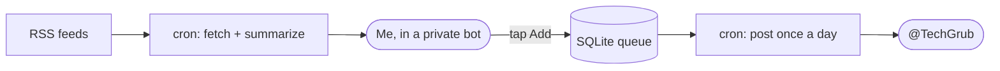
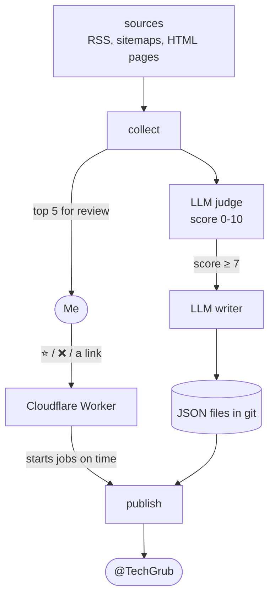

For months after TechGrub went quiet, people kept asking me what happened to it and when the daily posts would come back.

I didn't have a good answer. The honest one was: I just shut it down since it was a daily chore for me.

So this week I sat down and rebuilt it. In this post, I want to share how it started, why it stopped, and how the new version works without a server, without costing anything, and without needing me every day.

## How It Started

I've been reading engineering blogs for years. Company blogs like Netflix and Cloudflare, and personal ones like Lorin Hochstein and Will Larson. At some point my list had around 100 of them, and I was using an RSS reader and going through the posts almost every day.

Many of the posts I found were really good, and I thought it was a waste to keep them only for myself. So in August 2025, I created a Telegram channel called [TechGrub](https://t.me/TechGrub) and started sharing them. I also mentioned it briefly in my [2025 review](/2025-in-review/).

## The First Bot

The channel was the place for sharing daily new posts. But how was I choosing them? With a bot for controlling the content.

The idea behind the bot was simple:

- A cron job read all the feeds and picked up anything from the last 24 hours.
- An LLM (Llama on Groq) wrote a short summary for each one.
- Every new post was sent to me in a private Telegram bot, with buttons like "Add" and "Add to Top".
- Another cron job posted the top of the queue to the channel once a day.



All of it ran on a small paid server.

And it worked. Until January 2026, the channel posted about 30 times a month. Average views per post went from about 21 in the first month to around 140 in September.

## Why It Stopped

The main problem was that I was the middleman. Every single post needed my tap. With around 100 feeds, most new posts each day weren't worth sharing. Also, honestly, some days or maybe weeks I was not in the mood and didn't have the time or capacity to check those new posts.

There were other things too:

- **I was paying for a server** that ran all day for a free channel.
- **Posts got lost.** The bot only looked at the last 24 hours. If a run failed or a feed was late, those posts were gone. Sites without RSS, like Anthropic's blog, couldn't be followed at all.
- **The summaries were boring.** A lot of them started with "This article discusses…" or "Learn about…". They described the post, but didn't give a reason to read it.
- **Hashtags were random.** The LLM made new tags for almost every post, like #AIWorkflows and #HumanAgentInteraction, so nobody could use them to find anything.

None of these alone was a reason to stop. But together, the channel felt like a chore, and chores are the first thing you drop when life gets busy.

## What I Wanted This Time

Before writing any code, I wrote down what the new version should do:

1. **Cost $0.** No server.
2. **Not need me every day.** The bot picks the post. I can step in, but I don't have to.
3. **Post at a fixed time**, every evening, plus a weekly digest on Fridays (I may change the day later).
4. **Have better posts.** A real takeaway, who it's for, and how long it takes to read.
5. **Support formats other than RSS.** Some websites I wanted to follow didn't have an RSS feed, and because of that I couldn't add them to my list.

## How the New Version Works

There's no server anymore. Instead, it's built from a few free pieces:

- **GitHub Actions does the work.** There are a few jobs: one collects new posts every morning, one publishes in the evening, one builds the weekly digest, and one syncs my taps from Telegram.
- **Git is the database.** The state is a few JSON files (what was seen, what's a candidate, what was posted), and every job commits them back to the repo. So every decision has a history for free.
- **A tiny Cloudflare Worker is the mailbox.** It's about 110 lines of JavaScript. GitHub Actions only runs when something triggers it, so the bot is "asleep" most of the time. The Worker is always awake, receives my taps from Telegram, answers right away, and stores them until the next job picks them up. It also starts the jobs on time, because GitHub's scheduled runs are often 10 to 30 minutes late.
- **Free LLMs do the reading.** One call judges each post and gives it a score. A second call writes the post, but only for the good ones.
- Read from HTML or the sitemap in case of RSS absence. If a website doesn't have RSS, the bot can check the sitemap or HTML to find out about new posts.



Every morning I get the top 5 candidates in a private chat. I can star one, reject one, or send the bot a link I found myself. Or I can ignore it completely.

Later, the bot picks what to post in this order:

1. Something I starred.
2. A link I sent.
3. The best fresh post with a score of 7 or more.
4. The best post of the past week with a score of 6 or more.
5. If nothing is good enough, skip the day. No more "No new posts today".

It also never posts from the same source two days in a row, and it posts at most 2 podcasts a week. Lenny's Podcast alone was 39 of my old posts, so this rule was needed :)

One more small change made a big difference. Instead of "posts from the last 24 hours", the bot now remembers every URL it has seen. Anything new is a candidate, no matter when it showed up. If a run fails, nothing is lost. The next run just picks it up.

## Teaching an LLM My Taste

This was the most fun part.

The judge needs to know what kind of posts I like. Luckily, I had the best possible data: my own 403 past posts. I scraped them from the channel's public page and used them to write a short rubric. I like leadership essays, incident stories, real architecture deep dives, and honest takes on AI in engineering. I skip company PR, product launches, and generic self-help.

Then I built a small test set. Some good ones from the channel, some weaker ones I wouldn't post today, and some fake junk posts like hiring announcements and release notes.

Every time I changed the prompt, I ran it against this set and checked how many it got right.

## Free Really Means Free

I wanted the whole thing to cost nothing, and it does. But free tiers have limits, so I had to design around them.

Gemini's free tier, for example, gives only 20 requests a day per model, and sometimes it just says "high demand". So it's a fallback. The main model is `gpt-oss-120b` on Groq, which has been fine except on days I ran the 47-post test many times.

Because the judge reads only a short part of each post, and the writer only runs for the 5 to 10 good ones each day, the daily usage stays small. When a model runs out of quota, the bot stops using it for the rest of the run instead of retrying on every post.

GitHub Actions, the Cloudflare Worker, and the LLMs are all on free tiers. Total cost: **$0**.

## Before and After

Here's what a post looked like before:

```text
📖 MongoDB Read/Write vs. PostgreSQL Synchronous Replication
✍️ Franck Pachot
| Comparing MongoDB and PostgreSQL replication, debunking myths on data consistency and durability.
#mongodb #postgresql
@TechGrub
[Read More]
```

And now:

```text
Anthropic and the changing nature of work — Lorin Hochstein

| Reading all agent output in engineering and research would take 424 hours a week,
| so human attention is the absolute bottleneck.
💡 Worth it if you manage engineering teams adopting AI agents

#AI · @TechGrub
[Read · 6 min]
```

The new post gives you a reason to click, tells you who it's for, and shows the reading time on the button. The hashtag is now one of 7 fixed categories (AI, Architecture, Reliability, Leadership, Craft, Career, Product), so tapping it actually shows related posts.

## What's Next

Growth is still the problem I haven't solved. Telegram doesn't recommend channels to new people, and people don't share link channels much. 144 subscribers in more than a year is not a lot.

The first experiment is a weekly digest every Friday: 3 must-reads with a one-line hook each, and the rest in a collapsed section. Kind of a newsletter, but inside Telegram. If people like it, maybe I'll move it to a real newsletter later.


If you like engineering blogs and podcasts, you can join [TechGrub on Telegram](https://t.me/TechGrub). One post every evening, picked by a bot that learned from me. And yes, it's still free.
